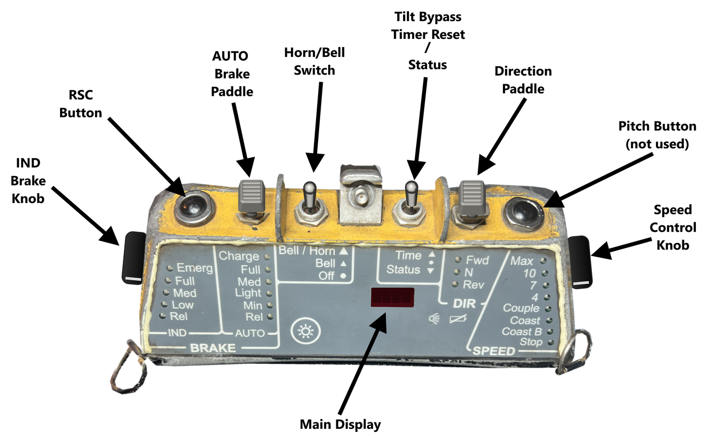

# Run8 OCU II

A desktop emulation of the CANAC / Cattron Beltpack OCU II remote control unit for
[Run8 Train Simulator V3](https://www.run8studios.com/). It drives a Run8 locomotive the way a yard
crew would with the real beltpack: speed selector, direction, train and locomotive brakes, the RSC
vigilance timer, penalty brake applications and the recovery procedures, the talker, and the
self-tests.

> **Status:** in development, currently in play testing with people who ran the real unit. The
> program and its source code will be published here later. For now this repository holds the
> documentation.

- [Operator's manual](docs/OCU-II-Manual.md): every control, indicator and procedure.
- [Scope and safety](docs/Scope-and-Safety.md): what the project will and won't contain.
- [To-do list](TODO.md): what's still being checked and built.

## Feedback

Ran the real OCU II? Your knowledge is the most valuable thing this project can get.

- **Something differs from the real unit, or you can fill a gap in the to-do list:** open an issue
  and choose [Compare with the real unit](https://github.com/NatFrench/Run8-OCU-II/issues/new/choose).
- **Bugs and ideas:** open an [issue](https://github.com/NatFrench/Run8-OCU-II/issues/new/choose).
- **Questions, chat and stories about the real unit:**
  [Discussions](https://github.com/NatFrench/Run8-OCU-II/discussions).

Please keep feedback to what an operator sees, hears and does. Don't post radio, protocol,
addressing or pairing details of real equipment.

## Scope and safety

This is a simulator for Run8 only. It talks to Run8 on the same PC and nothing else: it has no
radio, no connection to other computers, and no way to communicate with real locomotive or remote
control equipment.

This project is not, and won't become, a guide to reverse engineering remote control locomotive
systems. It doesn't document how real equipment communicates: no radio protocols, commands,
telemetry, addressing or pairing details.

## Licence

Copyright © 2026 Nathan French. Licensed under the [GNU General Public License v3.0](LICENSE),
which will also cover the code when it's published.

This project isn't affiliated with or endorsed by Cattron, CANAC, any railroad, or Run8 Studios.
Product names are trademarks of their respective owners and are used only to identify the equipment
being simulated.
