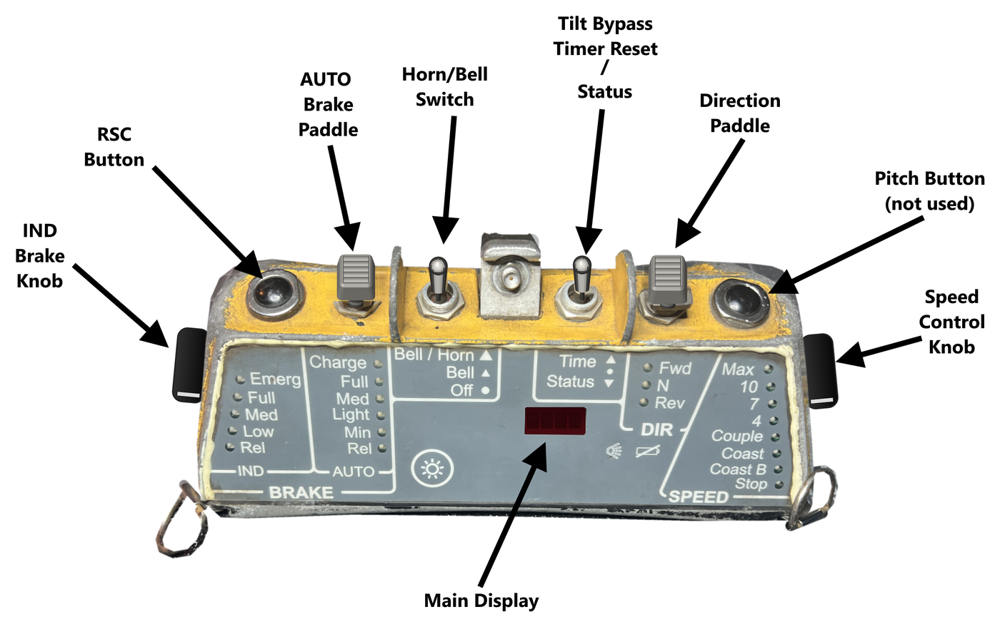

# Beltpack OCU II Operator's Manual

### Run8 RCL Controller: CANAC / Cattron Beltpack OCU II emulation

This manual explains every control, indicator, and procedure on the emulated beltpack (Operator
Control Unit, or OCU), and how to operate a Run8 locomotive with it the way a yard crew would with
the real thing.

Most of the behaviour follows CANAC's operating instructions: *CANAC RCLS Job Aid* (Canadian Pacific
Railway, rev. 07/06/2005), which is publicly available online. Section numbers like
"(job aid 5.2)" point to it. Where the real unit's behaviour isn't documented, the emulation makes a
reasonable guess. Those places are marked **[guess]**. Where Run8 forces a difference, it's marked
**[Run8]**. Section 13 collects all the differences in one place.

---

## Contents

1. [How remote control works](#1-how-remote-control-works)
2. [Setting up](#2-setting-up)
3. [The OCU at a glance](#3-the-ocu-at-a-glance)
4. [Controls in detail](#4-controls-in-detail)
5. [Display and indicators](#5-display-and-indicators)
6. [Sounds and the talker](#6-sounds-and-the-talker)
7. [Operating the locomotive](#7-operating-the-locomotive)
8. [Safety systems](#8-safety-systems)
9. [Penalty brake applications and recovery](#9-penalty-brake-applications-and-recovery)
10. [Required tests](#10-required-tests)
11. [Pitch and catch](#11-pitch-and-catch)
12. [Keyboard and settings](#12-keyboard-and-settings)
13. [Differences from the real unit](#13-differences-from-the-real-unit)
14. [Troubleshooting](#14-troubleshooting)
15. [Credits](#15-credits)

---

## 1. How remote control works

A remote control locomotive (RCL) has an on-board computer that takes commands from the operator's
beltpack over the radio. The operator never handles a throttle. Instead, they choose a **speed**
(Couple, 4, 7, 10 mph and so on) and a **direction**. The on-board computer applies power to reach
that speed and uses the locomotive brakes to stop it going faster.

Every safety function lives in that system:

- **Reset Safety Control (RSC):** an alertness check that must be acknowledged regularly.
- **Communication loss protection.**
- **Penalty brake applications** whenever something goes wrong.

Penalties can only be recovered with specific sequences on the beltpack.

In this program, the on-board computer runs on your PC and drives Run8 through Run8's Custom Input
Device interface. It sets the throttle, the independent brake, the train brake, the reverser, the
bell, horn, sander and headlights, just as the real system works the locomotive's controls.

---

## 2. Setting up

### 2.1 Run8

1. In Run8, open the **Controls** menu and find **Custom Input Device**.
2. Set its port to **18888** (or whatever `Run8Port` is in the settings file), then **enable** it.

The overlay sends commands to Run8 on that port. Run8 sends locomotive data (speed, air pressures,
status) back on the next port up (18889). Only one program can listen on 18889 at a time, so close
other Custom Input Device tools first.

### 2.2 Starting the overlay

Start the program:

- **Download:** unzip the download anywhere and run `Run8 Beltpack OCU.exe`. Nothing else needs
  installing. Windows may say "Windows protected your PC" because the program isn't signed by a
  publisher; click **More info**, then **Run anyway**.
- **Installed copy:** use the **Run8 Beltpack OCU** shortcut on the desktop or Start menu
  (installed with `tools\publish.ps1`).
- **From source:** `Beltpack.Overlay.exe` in `src\Beltpack.Overlay\bin\Debug\net10.0-windows\`
  after building.

The beltpack appears as a window that stays on top of Run8.

- **Move it:** drag on any blank part of the case.
- **Resize it:** hold Ctrl and turn the mouse wheel over it, or use right-click, then **Size**.
- **Settings menu:** right-click a blank part of the case. The menu has:
    - Changeover
    - Turn OCU on or off
    - Talker voice
    - Size
    - Opacity
    - Key bindings
    - Open settings file
    - Reload settings
    - Exit
- The overlay never takes keyboard focus away from Run8, so Run8's own keys keep working.

Move the mouse over the top of the antenna mount in the middle of the top edge and a strip of emulator buttons
rises from behind the unit (section 4.6). It slides away again a moment after the mouse leaves the
antenna mount or the strip. The right end of the strip shows the link to
Run8. A green dot with speed, BP and BC means Run8 is talking to the overlay. An amber dot with
"No data from Run8" means it isn't (see section 14).

### 2.3 Changeover: MANUAL and BELTPACK

On a real RCL locomotive, a **changeover switch** on the electrical panel selects either MANUAL
(normal cab control) or BELTPACK (remote control) (job aid 2.8). The **CAB** button on the emulator
strip does the same job:

- **CAB: MANUAL:** the overlay sends nothing to Run8. You drive from the cab with Run8's normal
  controls. The beltpack still runs, but only as a display.
- **CAB: BELTPACK:** the overlay takes over the throttle, both brakes, the reverser, bell, horn,
  sand and headlights. It re-sends the lever positions twice a second, so cab keys can't leave them
  out of step. On changeover it also turns off Run8's slow speed control (Ctrl+C), which would
  otherwise cut power below the selected speed.

The talker announces each changeover.

---

## 3. The OCU at a glance

The emulator strip (section 4.6) rises from behind the unit while the mouse is over the top of the
antenna mount: **POWER**, **HEADLT**, **SAND** and **CAB**, then the link to Run8.

Each legend has a small red lamp (LED) beside it. A steady lamp shows the selected position. A
flashing lamp means the OCU wants something from you (see section 5.2).

**Using the mouse:**

| Control type | How to operate it |
|---|---|
| Any printed position (Emerg, Rel, Fwd, Stop, 4, ...) | Click it to move that control straight to that position |
| Knobs and paddles (IND knob, SPEED knob, AUTO paddle, DIR paddle) | Left-click steps up one position, right-click steps down, the wheel goes either way. The AUTO paddle stays pushed while you hold the button, then springs back. |
| Push buttons (RSC, PITCH) | Hold the left button for as long as you'd hold the real button |
| Time/Status toggle | Right-click and hold to push it down for Status. The word Status also works when held. |
| Bell/Horn toggle | Click to step the toggle up, right-click to step it down. From Off, a click latches it at Bell; from Bell, click and hold for horn, and it springs back to Bell when you let go. Holding the words Bell / Horn also sounds the horn, and the words Bell and Off select those positions. |
| Emulator strip buttons | Click (SAND: hold) |

---

## 4. Controls in detail

### 4.1 SPEED selector (right-hand knob)

The speed selector requests a speed, not a throttle notch. The on-board computer uses power when
the train is slower than the selected speed and the locomotive brake when it's faster. It never uses
both at once.

| Position | What it does |
|---|---|
| **Stop** | No power. A moving train is braked to a stand still. |
| **Coast B** | No power and a light locomotive brake. On a shove this stretches the slack and eases the train down without a jolt, the same as selecting Coast and setting IND by hand but done one-handed. How strong the brake is on the real unit isn't known yet; the emulator uses the same amount as IND Low. |
| **Coast** | No power, no brake. The train rolls freely. |
| **Couple** | About 1 mph, for coupling (job aid 1.6). |
| **4** | 4 mph. |
| **7** | 7 mph. **[guess]** Labelled on the unit. Speed assumed from the legend. |
| **10** | 10 mph. **[guess]** As above. |
| **Max** | 15 mph. **[guess]** The real maximum is set per railroad. |

Starting from Stop, any position above Coast needs **RSC pressed first** (see section 7.3).
Otherwise the train won't move and the SPEED lamp flashes.

### 4.2 DIR: direction paddle (top right)

**Fwd**, **N** (neutral) and **Rev**. This is the locomotive reverser. The paddle stays in whichever
of its three positions you put it.

- The direction only changes while the train is stopped (direction-of-movement protection). If you
  move DIR while rolling, the DIR lamp flashes and the change happens once the train stops.
- In **N**, the locomotive won't load.
- The headlight at the leading end follows the direction (see HEADLT DIM below).

### 4.3 AUTO: train brake selector (top left paddle)

This controls the **automatic (train) air brake**, the brakes on the whole train, through the brake
pipe. The paddle is spring-loaded: each push steps the brake one position toward Charge, each pull
steps it one position toward Rel, and the paddle returns to centre when you let go. The AUTO lamps
show the selected position. Each position asks for a set reduction of the equalizing reservoir:

| Position | Reduction | Use |
|---|---|---|
| **Rel** | none | Release the train brakes. The normal running position. |
| **Min** | 7 psi | Minimum application, for example stretching or conditioning brake shoes (job aid 1.13) |
| **Light** | 10 psi | |
| **Med** | 15 psi | |
| **Full** | 26 psi | Full service, for stopping and for securing standing equipment (job aid 1.7, 1.8) |
| **Charge** | none | Charge the brake pipe after putting cars on air (job aid 8.1). The locomotive brake is held fully applied in this position. |

- Applications are ramped smoothly, about 10 seconds from release to full service. Jumping straight
  to full service makes Run8 throw an undesired PCS open fault. **[Run8]** Releases are
  immediate.
- The locomotive **won't take power unless AUTO is in Rel**.
- Moving AUTO to Rel after an application starts **brake recovery**. The display shows `CHRG` and
  the AUTO lamp flashes until the brake pipe has recharged (within 4 psi of the feed valve, with
  airflow down to 20 CFM). Then you hear the unsolicited **"Brake recovery complete"** message, and
  only then can the train move again. This is the real system's state-of-charge protection (job aid
  1.12).

### 4.4 IND: brake override (left-hand knob)

This is the **locomotive (independent) brake**. It works on top of whatever the speed control is
doing.

| Position | Effect |
|---|---|
| **Rel** | No extra locomotive brake. The normal running position. |
| **Low** | Light locomotive brake application (used in the running brake test) |
| **Med** | Medium application |
| **Full** | Full locomotive brake |
| **Emerg** (ES) | **Emergency.** Full locomotive brake, brake pipe vented to zero, emergency penalty. |

- The locomotive won't take power unless IND is in Rel.
- **Moving IND into Emerg always causes an emergency penalty**, even when standing still. Recovering
  takes at least a minute (section 9.2). The job aid uses Emerg on purpose when leaving the OCU or
  entering the locomotive nose (job aid 7.0). Don't go past Full unless you mean it.

### 4.5 Push buttons on the top edge

- **RSC (Reset Safety Control)** (top left corner)
    - Press it regularly while working to show you're alert (section 8.1).
    - Press it before selecting a speed from Stop (section 7.3).
    - Press it as part of every penalty recovery (section 9).
- **PITCH** (top right corner): hands control to the second OCU (section 11). There is no second OCU
  in this emulation, so it reports `PITCH FAILED`.
- **Time / Status toggle** (both positions are momentary; it springs back to centre)
    - **Up (Time)**: on the real unit, holding Time until the double beep starts a **tilt
      time-out**. It bypasses the tilt (man-down) protection for a short time, for work that needs
      the OCU tipped past 45 degrees without an emergency penalty. This feature is not currently
      simulated.
    - Push **down (Status)** for a **status report**: a short message on the display, plus a spoken
      talker message with the locomotive number, OCU letter, current condition, any penalty cause,
      and brake pipe pressure.
    - When the OCU is waiting for something (a recovery, brakes charging, a PCS reset), Status tells
      you what.
- **Bell / Horn toggle**
    - **Up (Bell/Horn ▲)** is momentary: horn and bell while held. It springs back to where it was.
    - **Middle (Bell)**: bell on.
    - **Down (Off)**: bell off.
    - Run8's bell is a push button that turns the bell on or off with each press, so moving the toggle
      presses it as needed to match Run8's bell to the toggle. If you switch the bell in Run8 itself,
      the toggle leaves it alone until you next move the toggle.

### 4.6 Emulator strip (rear panel functions)

These functions aren't on the face of the real unit. Move the mouse over the top of the antenna mount in the
middle of the top edge and they rise on a strip from behind the unit; the strip slides away again a
moment after the mouse leaves the antenna mount or the strip.

| Button | Function |
|---|---|
| **POWER** | Turns the OCU on or off. Power-on starts the self-test (section 7.1). Turning it off with the beltpack in control leaves the locomotive brake applied and the throttle at idle. |
| **HEADLT DIM** | Switches the headlight between bright and dim. Bright lights the headlight at the leading end only (front for Fwd, rear for Rev). The other end stays dim. The headlight icon by the display lights when bright is selected. |
| **SAND** | Hold to sand the rails. Sand is also applied automatically during wheel slip. |
| **CAB** | Changeover between MANUAL and BELTPACK (section 2.3). |

---

## 5. Display and indicators

### 5.1 The display

The display is four separate 5×7 dot-matrix character modules behind a red filter, each with a
decimal point after it. It normally shows the **locomotive's actual speed** in mph (for example
`4.0`). Longer messages scroll through it a character at a time. In order of priority, it shows:

| Display | Meaning |
|---|---|
| `TEST` | Self-test after power-on. All lamps light for the first 2 seconds (lamp test). |
| `OK 4026 A F1` | Self-test passed. Shows the locomotive number, OCU letter and radio channel it's programmed for (job aid 2.10). The locomotive number is the one you control in Run8, when it can be read (section 12.2). |
| *(any status message)* | Shown for 6 seconds after pressing Status |
| `RECOVERED` | A penalty recovery was accepted |
| `BRAKE RECOVERY COMPLETE` | Brake pipe recharged after a release. The train may move. |
| `PITCH FAILED` | Pitch wasn't caught (single OCU) |
| `RSC` | RSC warning. Press RSC now. |
| `NO LINK` | No data from the locomotive (Run8) for 3 seconds |
| `PCS 87` | Run8's PCS is open. Seconds left until it can be reset (section 9.5). **[Run8]** |
| `EMG PEN` | Emergency penalty in effect |
| `TBK PEN` | Train brake penalty in effect |
| `SVC PEN` | Service penalty in effect |
| `CHRG` | Brake recovery in progress (brake pipe charging) |
| `4.0` | Normal: actual speed |

The exact wording on a real OCU II display isn't documented. These messages are stand-ins
**[guess]**. The spoken status messages use the job aid's wording.

### 5.2 Lamps

- **Steady:** the selected position.
- **Flashing:** the OCU is asking for action.

| Flashing lamp | Meaning |
|---|---|
| SPEED | A speed above Coast is selected but the train can't move: RSC wasn't pressed first, or power is blocked (section 8.4) |
| AUTO | Brake recovery in progress, or a train brake penalty is waiting for recovery |
| IND | An emergency or service penalty is waiting for recovery |
| DIR | DIR was moved while rolling. The change takes effect once stopped. |

The **headlight icon** lights when the headlight is set to bright. The **battery icon** only lights
during the lamp test. Battery level isn't simulated.

---

## 6. Sounds and the talker

The OCU has a small beeper. The locomotive also has a **talker**, a voice that broadcasts on the
crew's portable radios. Your PC speakers stand in for both. The talker's voice is a stand-in
(a Windows speech voice) until the real unit's voice can be sourced.

| Sound | Meaning |
|---|---|
| Short beep | A control was moved or a button pressed |
| Double beep | "PCS reset" ready |
| Falling three-tone | A penalty brake application has occurred |
| Low double tone | Communication with the locomotive was lost |
| Pulsing alarm | RSC warning: press RSC within 10 seconds |

Talker messages include:

- "Changeover to beltpack" and "Changeover to manual".
- The penalty cause followed by its recovery instruction, for example "Reset safety control
  timeout. Recover train brake from beltpack."
- Unsolicited "Brake recovery complete".
- Spoken status reports (Status button).
- "P C S reset. Recover emergency from beltpack."
- "Pitch failed".

The real beeps are undocumented, so these sounds are stand-ins **[guess]**. Turn the talker on or
off from the right-click menu. Volume is in the settings file.

---

## 7. Operating the locomotive

### 7.1 Power-up and self-test (job aid 2.9)

1. With CAB in MANUAL, click **POWER**.
2. The OCU runs its self-test: `TEST` on the display, with all lamps lit briefly. The real unit
   takes about 60 seconds. The emulation takes 10 by default. **[changed for convenience]**
3. The display shows `OK` with the locomotive number, OCU letter and channel.
4. As on the real unit, every power-up ends in a **System reset** train brake penalty (`TBK PEN`).
   Press **Status** and follow the instruction: *"Recover train brake from beltpack"* (section 9.3).
5. Click **CAB** to change over to BELTPACK when you're ready to take control.

### 7.2 Before moving

- Do the required tests when taking charge of a locomotive (section 10).
- Make sure Run8's hand brake is off and the locomotive is set up to run (engine running, isolation
  switch in Run).
- Positions for moving: AUTO in **Rel**, IND in **Rel**, DIR in **Fwd** or **Rev**, and no "brake
  recovery" in progress.

### 7.3 Starting a movement

1. Set **DIR** to Fwd or Rev.
2. Press **RSC**, then **within 3 seconds** move SPEED to the speed you want (for example Couple or
   4) (job aid 3.5 step 5, 3.6 step 3).
3. Check the train is moving in the direction you asked for (job aid 1.10).

If you miss the 3-second window, the SPEED lamp flashes and nothing happens. Go back to Stop, or
press RSC and move SPEED again. Once moving, you can change between speeds freely without RSC.

### 7.4 Changing speed and stopping

- Move SPEED up or down. The train accelerates under power or slows using the locomotive brake.
- **To stop:** move SPEED to **Stop**. Power comes off, the locomotive brake slows the train at about 1 mph per second, and once it's stopped the full locomotive brake applies.
- **With cars:** the locomotive brake alone may not hold a heavy train. Use AUTO (train brake) to
  stop it: Min to Full as needed. Then put SPEED to Stop, return AUTO to Rel, and wait for "Brake
  recovery complete" before moving again (job aid 5.5).

### 7.5 Coupling (job aid 1.6)

1. Slow to about 1 mph with SPEED in **Couple** when 6 to 12 feet from the equipment.
2. Move SPEED to **Stop** just before coupling.

### 7.6 Changing direction

Stop completely (SPEED to Stop), move DIR, then press RSC and select a speed within 3 seconds.

### 7.7 Putting cars on air (job aid 8.1)

1. Couple on and stretch to test the coupling.
2. Set DIR to **N**.
3. Move AUTO to **Charge**.
4. Cut in the air on the cars (in Run8).
5. Move AUTO to **Rel**.
6. Wait for "Brake recovery complete".

### 7.8 Three-point protection (job aid 1.7)

Before anyone goes between equipment:

1. SPEED in **Stop**.
2. DIR in **N**.
3. AUTO in **Full** when protecting someone else.

To resume, return AUTO to Rel and wait for "Brake recovery complete" (job aid 11.2).

---

## 8. Safety systems

### 8.1 Reset Safety Control (RSC)

Whenever SPEED is off Stop, or the train is moving, the RSC timer runs.

1. After **50 seconds** without an RSC press, the **pulsing alarm** sounds and the display shows
   `RSC`.
2. After **10 more seconds**, a **train brake penalty** occurs (job aid 3.2).

Pressing RSC resets the timer. So does moving any control on the OCU. **[guess]** The job aid isn't
clear whether other controls reset it.

### 8.2 Communication loss

If the locomotive stops answering for **3 seconds**, the OCU gives the low double tone and the
display shows `NO LINK`. This happens if Run8 closes or the Custom Input Device is disabled. If the train was cleared to move at the time, a **service penalty** occurs.

### 8.3 Direction-of-movement protection

The reverser only changes while the train is stopped (section 4.2).

### 8.4 Power interlocks

The on-board computer won't apply power if any of these are true:

- AUTO is not in Rel.
- IND is not in Rel.
- DIR is in N.
- Brake recovery is still in progress.
- Main reservoir is below 110 psi.
- Run8's PCS is open.

The speed lamp flashes if you've asked for a speed while power is blocked. For the air-related
conditions, **Status** tells you which one it is, using the job aid's messages (job aid 1.12):

- "Brake charging in progress"
- "Brake recovery in progress"
- "Low main reservoir pressure"
- "P C S open"
- "Release train brake from beltpack"

Check the IND and DIR lamps yourself.

### 8.5 Automatic functions

- **Wheel slip:** power is cut back and sand applied automatically.
- **Cab alerter:** Run8's cab alerter is acknowledged automatically in BELTPACK, as on a real RCL
  locomotive, where RSC replaces it.
- **Slow speed control:** turned off in Run8 at each changeover to BELTPACK.

### 8.6 Tilt protection (man-down)

The real OCU has a tilt sensor. If the unit tips past 45 degrees, for example because the operator
has fallen, a continuous alarm sounds and the display warns of the tilt. If the OCU isn't stood
upright within a few seconds, an emergency penalty applies. Holding **Time** until the double beep
starts a tilt time-out, which bypasses the protection for a short time for work that needs the OCU
tipped (section 4.5).

This feature is not currently simulated.

---

## 9. Penalty brake applications and recovery

When the system detects a problem, it stops the movement with one of three penalty applications
(job aid 5.0). The penalty is announced by the falling three-tone, the display code, and the talker
giving the cause and recovery instruction. Press **Status** at any time to hear the recovery
instruction again.

| Penalty | Display | Brake application | Caused by |
|---|---|---|---|
| **Service** | `SVC PEN` | Full locomotive brake | Communication loss while cleared to move |
| **Train brake** | `TBK PEN` | Full locomotive brake plus full-service train brake | Power-up (System reset), RSC timeout |
| **Emergency** | `EMG PEN` | Full locomotive brake, brake pipe vented to zero, reverser centred | IND moved to Emerg, Run8's PCS opening for any reason |

All recovery steps that need RSC must be completed **within 3 seconds** of pressing RSC, and in the
order shown. If you're too slow, start again from the RSC press.

### 9.1 Recover service from beltpack (job aid 5.4)

1. Move SPEED to **Stop**.

### 9.2 Recover emergency from beltpack (job aid 5.2)

1. Wait for the train to stop. The emulation also requires **60 seconds** after the emergency
   **[guess]**, and the PCS countdown to finish if one is shown (section 9.5).
2. Move SPEED to **Stop**.
3. Make sure AUTO is in **Rel**. Charge doesn't count.
4. Move IND (brake override) to **Emerg** (the "ES" position). It may already be there.
5. Press **RSC**, and **within 3 seconds**:
6. Move IND to **Rel**.
7. The display shows `RECOVERED` then `CHRG`. Wait for the unsolicited **"Brake recovery
   complete"**.

> **Mouse tip:** click the word "Emerg" in the IND column, click RSC, then click the word "Rel" in
> the IND column. Three clicks.

### 9.3 Recover train brake from beltpack (job aid 5.3)

1. Move SPEED to **Stop**.
2. Move AUTO to **Full**.
3. Press **RSC**, and **within 3 seconds**:
4. Move AUTO to **Rel**.
5. Wait for the unsolicited **"Brake recovery complete"**.

### 9.4 Release train brake from beltpack (job aid 5.5)

This isn't a penalty. It's what you do after any train brake application of your own.

1. Move SPEED to **Stop**.
2. Move AUTO to **Rel**.
3. Wait for the unsolicited **"Brake recovery complete"**.

### 9.5 The PCS in Run8 [Run8]

An emergency brake application in Run8 opens the locomotive's **PCS** (pneumatic control switch).
While it's open, the brake pipe can't charge and the locomotive won't load. Run8 only resets it once
the **reverser has been in neutral and the train brake fully applied for 2 minutes**, followed by a
release.

The beltpack handles this for you. During an emergency penalty in BELTPACK, it holds the reverser in
neutral and the train brake in emergency, and counts down on the display (`PCS 120`, `PCS 119`, ...).
When the count reaches zero, it double-beeps and says *"P C S reset. Recover emergency from
beltpack."* Then do the normal emergency recovery (section 9.2). The release at the end of the
recovery closes the PCS.

The countdown only runs while the train is stopped and Run8 is connected. If the PCS opens on its
own (a broken train line, or a brake application Run8 considers too sudden), the OCU treats it as an
emergency and applies an emergency penalty.

---

## 10. Required tests

The job aid requires these tests when taking charge of RCL equipment (job aid 2.11, 3.0, 4.1). They
all work on the emulation and are good practice for learning the unit. Secure the equipment against
movement first.

### 10.1 Status test (job aid 3.1)

1. Press **Status**.
2. Check you hear the talker message.

### 10.2 RSC test (job aid 3.2)

1. DIR in **N**.
2. Press **RSC** and move SPEED to **Coast**.
3. After **50 seconds**, the pulsing alarm sounds.
4. After **10 more seconds**, a train brake penalty applies. Brake pipe pressure should drop at
   least 25 psi (watch BP in Run8 or on the overlay's link strip).
5. Recover train brake from beltpack (section 9.3) and check you hear the recovery message.

The real locomotive revs up during this test. The emulation doesn't, because idling with the
reverser in neutral has no effect in Run8.

### 10.3 Miscellaneous tests (job aid 3.4)

- Check the bell and horn work (Bell/Horn toggle).
- Check the headlights work (HEADLT DIM, with DIR in Fwd and in Rev).

### 10.4 Locomotive/OCU air brake test (job aid 3.5)

Required after a System reset or when taking charge. The locomotive will move during this test.

1. Release Run8's hand brakes.
2. AUTO must have been in **Rel** for at least 2 minutes.
3. Set DIR to Fwd or Rev.
4. Press RSC, and move SPEED to **Couple** within 3 seconds.
5. Check the locomotive moves in the selected direction and all brakes release.
6. Set IND to **Low**. Check the brakes apply.
7. Set IND to **Rel**. Check the brakes release.
8. Move AUTO to **Min**. On the real system, brakes remain released. In Run8, a light engine may
   show a small application.
9. Move AUTO to **Full**. Check the brakes apply and the locomotive stops.
10. Move SPEED to **Stop**.
11. Move AUTO to **Rel**.
12. Listen for the unsolicited "Brake recovery complete".

### 10.5 Running brake test (job aid 3.6)

1. Set DIR to Fwd or Rev.
2. Press RSC, and move SPEED to **4** within 3 seconds.
3. Set IND to **Low**. Check the brakes apply firmly.
4. Move IND to **Rel**.

---

## 11. Pitch and catch

A real crew works with two OCUs (A and B). Control is passed between them with **pitch and catch**
(job aid 6.0):

1. The train is stopped, with both SPEED selectors at Stop and both AUTO selectors matching.
2. The controlling operator presses PITCH.
3. The receiving operator presses RSC within 10 seconds.

This emulation has a single OCU, so PITCH always reports `PITCH FAILED` and "No receiving O C U".
The OCU letter and channel shown at power-up come from the settings file.

---

## 12. Keyboard and settings

### 12.1 Keyboard (optional)

Every function works with the mouse. Keyboard keys can be bound to OCU controls if you prefer. They
work while Run8 or the beltpack is the active window. Bound keys are hidden from Run8, so they don't
also trigger Run8 commands.

The default bindings use the **numeric keypad**, with NumLock on:

| Key | Function | Key | Function |
|---|---|---|---|
| Num 8 / Num 2 | SPEED up / down | Num 5 | RSC |
| Num 6 / Num 4 | DIR toward Fwd / Rev | Num 0 | Horn (hold) |
| Num 9 / Num 3 | AUTO apply / release | Num . | Bell on/off |
| Num 7 / Num 1 | IND apply / release | Num + | Status |
| Num - | Time | Num / | Pitch |
| Num * | Headlight bright/dim | Scroll Lock | Sand (hold) |
| *(unbound)* | Power, Changeover | | |

To change them:

1. Right-click the case, then choose **Open settings file**.
2. Edit the `"Keys"` section. Key names follow Windows naming, for example `"Q"`, `"D1"` (top-row
   1), `"F5"`, `"OemComma"`, `"Space"`.
3. Available actions: `SpeedUp`, `SpeedDown`, `DirForward`, `DirReverse`, `AutoApply`,
   `AutoRelease`, `IndApply`, `IndRelease`, `Rsc`, `Horn`, `Bell`, `Status`, `Pitch`, `Headlight`, `Sand`, `Power`, `Changeover`.
4. Save the file, then right-click and choose **Reload settings**.

Avoid keys Run8 uses that you still want in the cab.

### 12.2 Settings file

`%LocalAppData%\Run8RclController\settings.json`, which you can open from the right-click menu.
Changes take effect after **Reload settings**. Useful settings:

| Setting | Default | Meaning |
|---|---|---|
| `LocomotiveId`, `OcuLetter`, `Channel` | 0000, A, F1 | What the OCU is "programmed" for. Shown at power-up and spoken in status. `LocomotiveId` is only used when the locomotive can't be read from Run8 (below). |
| `LocomotiveFromRun8` *(top level)* | true | Use the unit number of the locomotive you control in Run8 instead of `LocomotiveId`. Run8 doesn't send it to input devices, so it's read from `Run8.log` in the game folder, which records it each time you take a train. |
| `Run8Folder` *(top level)* | *(empty)* | Run8's install folder. Only needed if the folder can't be found from the running game. |
| `IndLow`, `IndMed`, `IndFull` | 70, 150, 255 | Independent brake handle for each IND position (0 to 255) |
| `MinReductionPsi` ... `FullReductionPsi` | 7, 10, 15, 26 | Train brake reduction for each AUTO position |
| `SelfTestSeconds` | 10 | Self-test length. Set 60 for the real unit's timing. |
| `RscTimeoutSeconds`, `RscWarningSeconds` | 50, 10 | RSC alarm and penalty timing |
| `RscWindowSeconds` | 3 | Time allowed after RSC for the next step |
| `EmergencyMinimumSeconds` | 60 | Minimum wait before an emergency can be recovered |
| `LowMainReservoirPsi` | 110 | Power is blocked below this |
| `TalkerEnabled`, `TalkerVolume`, `SoundVolume` | | Voice and beeper |

The settings file stores every value. If a future version changes a default, your file keeps the
old value until you edit it.

### 12.3 Event log

`%LocalAppData%\Run8RclController\events.log` records a line whenever the OCU's state changes:
penalties, commands sent to Run8, and Run8's status flags with speed and air pressures. It's useful
for working out what happened after an unexpected penalty.

---

## 13. Differences from the real unit

| Area | Real OCU II | This emulation |
|---|---|---|
| Radio, repeaters, OCU programming (OPP) | Two-way radio link, infrared programming | Direct link to Run8. Programming is the settings file. |
| Self-test | About 60 seconds | 10 seconds by default (adjustable) |
| Second OCU, pitch and catch | Supported | Single OCU. PITCH always fails. |
| Display wording and beeps | Undocumented | Stand-ins |
| Coast B brake strength, 7, 10, Max positions | Undocumented | Best guesses (section 4.1) |
| Tilt sensor and tilt time-out (Time) | Built in | Not in this version |
| Emergency recovery wait | Undocumented | 60 seconds plus Run8's 2-minute PCS reset |
| RSC test revving the engine | Engine revs in neutral | No rev |
| AUTO Min on a light engine | Locomotive brakes stay released | Run8 may apply a little locomotive brake |
| Battery, strobe lights, ATT'N button, snow brake | Present | Not simulated |
| Speed control | On-board computer, railroad-tuned | Tuned against Run8 telemetry on light engines. Heavy trains may behave differently. |

---

## 14. Troubleshooting

| Problem | What to check |
|---|---|
| Link strip says "No data from Run8" / display `NO LINK` | Custom Input Device enabled in Run8's Controls menu on the right port. |
| "Port 18889 is in use by another program" | Another tool (or a second copy of the overlay) is listening. Close it, then right-click and choose **Reload settings**. |
| Selected a speed but nothing happens, SPEED lamp flashing | RSC wasn't pressed within 3 seconds before selecting a speed, or power is blocked (AUTO or IND not in Rel, DIR in N, brakes charging). See section 8.4. |
| Display stuck on `EMG PEN` | Follow section 9.2 exactly, in order: Stop, AUTO Rel (not Charge), IND Emerg, RSC, then IND Rel within 3 seconds. Wait at least 60 seconds after the emergency, and for any `PCS` countdown to finish, before pressing RSC. |
| Display shows `CHRG` for a long time | The brake pipe is still charging. Check Run8's main reservoir and that the brake pipe isn't open somewhere (angle cocks, broken train line). |
| Locomotive doesn't respond at all | CAB must be in **BELTPACK**. In MANUAL, the overlay doesn't send anything. |
| Train won't reach the selected speed | Run8's slow speed control may be on (changeover to BELTPACK again turns it off). Check traction motors and that the hand brake is off. |
| The talker is silent | Right-click and check **Talker voice** is ticked. Windows needs an installed speech voice. |

---

## 15. Credits

Run8 RCL Controller was designed, photographed and tested by **Nathan French**, and written together
with Cursor's AI coding agent over the first nights of November 2026: V1 in a single night, then the
photo faceplate, rendered switches and the rest of V1.1 the next.

The faceplate is built from Nathan's photos of a real OCU II. Operating behaviour follows the CANAC
RCLS Job Aid, with the remaining guesses checked as feedback comes in from people who have run the
real unit.

Project page: [github.com/NatFrench/Run8-OCU-II](https://github.com/NatFrench/Run8-OCU-II)
